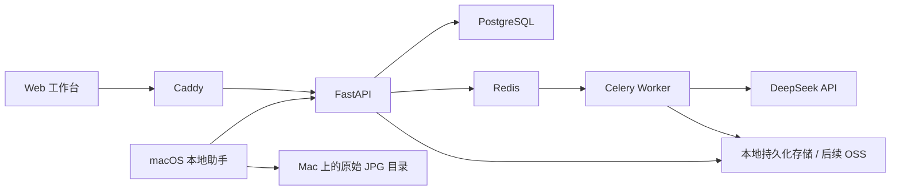

# 摄影工作流辅助软件：需求、技术选型与执行计划

> 更新日期：2026-10-30（Asia/Shanghai）  
> 文档状态：需求基线与实施规划，包含已确认规则、当前技术默认值和待细化事项。  
> 实施状态：尚未开始功能开发、原型开发或部署。本次仅整理文档。  
> 当前目标：个人使用，macOS 本地助手，JPG/JPEG，本地 Docker Compose 测试，DeepSeek 自配 API Key。

开发执行约束见 [AGENTS.md](AGENTS.md)，流程、变更记录模板和检查入口见 [开发指南](docs/DEVELOPMENT.md)。本文件继续作为业务需求与技术默认值的基线。

## 目录

1. [产品定位与首版范围](#1-产品定位与首版范围)
2. [术语、模块与数据关联](#2-术语模块与数据关联)
3. [全模块 AI 录入与处理状态](#3-全模块-ai-录入与处理状态)
4. [碎片化灵感文字](#4-碎片化灵感文字)
5. [摄影项目与拍摄策划](#5-摄影项目与拍摄策划)
6. [器材与道具库](#6-器材与道具库)
7. [创意与参考资料库、链接采集](#7-创意与参考资料库链接采集)
8. [拍摄照片库、本地助手与在线筛片](#8-拍摄照片库本地助手与在线筛片)
9. [归片、重新定位与撤销](#9-归片重新定位与撤销)
10. [成片与交付](#10-成片与交付)
11. [DeepSeek 配置、发送范围与费用控制](#11-deepseek-配置发送范围与费用控制)
12. [模块化架构与技术选型](#12-模块化架构与技术选型)
13. [本地部署、存储与数据保障](#13-本地部署存储与数据保障)
14. [分阶段执行计划](#14-分阶段执行计划)
15. [验收与测试场景](#15-验收与测试场景)
16. [仍需细化的事项](#16-仍需细化的事项)
17. [已替换或暂缓的方案](#17-已替换或暂缓的方案)
18. [参考资料](#18-参考资料)

## 1. 产品定位与首版范围

### 1.1 产品目标

为摄影师个人建立一套摄影工作流辅助软件，同时满足个人程序员持续维护和扩展的需要。

主要流程：

**灵感收集 → 项目策划 → 拍摄准备 → 本地 JPG 导入 → 在线筛片 → 本地归片 → 成片管理与交付。**

核心价值：

- 减少手工分类、填表和反复整理。
- 可以直接投入图片、文字、链接，由 AI 辅助识别、归位和结构化。
- 碎片灵感保留原文，以气泡展示。
- 把拍摄计划、参考资料、器材道具和后续照片关联起来。
- 支持本地原始 JPG 与线上预览、筛片结果保持关联。
- 各业务模块独立，方便增删功能、局部修改和长期维护。

### 1.2 使用方式

- 以 Web 为主要界面，前后端分离。
- 电脑用于完整管理、策划、筛片和归片。
- 手机支持随时记录、补充资料和查看。
- 第一版主要由个人登录使用。
- 当前在本地电脑通过 Docker Compose 运行和测试。
- 本地助手暂时仅支持 macOS。
- 拍摄照片第一版仅支持 JPG/JPEG。
- 默认使用 DeepSeek 官方 API，由用户自行配置 API Key。
- 后续保留部署到服务器及配置 OSS 的能力。

### 1.3 第一版边界

纳入第一版：

- 摄影项目、创意参考、器材道具、拍摄照片、筛片、成片及交付记录。
- 全模块 AI 辅助录入。
- 原文灵感气泡、AI 归位、手动总结。
- 可编辑色板与可拖拽布光图。
- 文字需求匹配器材道具，用户确认后关联。
- Mac 本地 JPG 扫描、预览生成、上传及归片。
- 手动触发的批量照片 AI 分析。
- 本地容器化运行、持久化、日志及备份恢复验证。

暂不纳入：

- RAW 读取、解码及 RAW/JPG 配对。
- Kubernetes 部署。
- 客户在线选片与下载门户。
- 器材外借、取出归还、维修、报废等完整流转。
- 替代 Lightroom、Photoshop 的专业修图功能。
- 完整视频理解及视频剪辑。
- 自建 GPU 推理平台。
- 预约、报价、合同、收款等完整经营管理。

后续能力不等于已安排开发，需另行确认优先级。

## 2. 术语、模块与数据关联

### 2.1 模块定义

| 模块 | 数据与职责 | 与项目的关系 |
|---|---|---|
| 摄影项目与策划 | 拍摄时间、主题、策划、参考、色板、清单、布光及成果 | 组织一次拍摄 |
| 器材与道具库 | 影棚实物、数量、位置、移位、盘点 | 可独立存在，同一物品可以被多个项目引用 |
| 创意与参考资料库 | 参考图片、链接、灵感原文、拍摄方法、标签及收藏 | 可独立存在，同一资料可以关联多个项目 |
| 拍摄照片库与筛片 | 本地 JPG 索引、线上预览、评分、筛选和文件位置 | 可独立存在，一份照片最多关联一个项目 |
| 成片与交付 | 成片版本、集合、导出及交付记录 | 关联拍摄照片和项目 |
| AI 收集与结构化能力 | 统一接收、解析、归位、结构化、匹配和任务状态 | 向各模块提供基础能力 |
| 系统设置 | AI、存储、本地助手连接等配置 | 全局配置 |

后续统一使用“创意与参考资料库”和“拍摄照片库”，不单独使用含糊的“素材库”。

### 2.2 通用关联规则

- 器材与道具库、创意与参考资料库、拍摄照片库均可独立使用。
- 新建库内内容不要求先创建项目。
- 项目通过关联组织库内内容，尽量通过引用复用，不重复创建相同资料。
- 删除项目或解除关联，保留库内资料和本地文件。
- 库内公共数据与项目专属数据分开保存。

例子：

| 库内数据 | 项目专属数据 |
|---|---|
| 器材型号、当前位置、库内数量 | 项目需求数量、准备备注、准备状态 |
| 参考图原始来源、共享标签 | 当前项目参考光线还是服装的说明 |
| 照片元数据、当前文件位置、全局评分 | 所属项目、该项目的入选结果和修图安排 |

项目删除后的项目专属内容归档、回收站和恢复方式仍需细化；不得因此级联删除三个库的数据或移动本地原件。

### 2.3 拍摄照片唯一项目归属

- 一份拍摄照片最多关联一个项目，也可以暂时不关联。
- 添加时检查当前归属，已属于其他项目的照片禁止重复关联。
- 提示应显示所属项目名称，并提供查看入口。
- 提示示例：“此照片已关联项目『项目名称』，请先解除原关联。”
- 批量关联时，处理无冲突项，汇总显示被拦截照片和所属项目。
- 更换项目需要先解除旧关联，系统不自动转移。
- 变更关联本身不触发本地文件移动。
- 重复扫描、导入或归片后，应继续识别为原登记文件。
- 文件名不是唯一标识；要结合来源、相对路径及文件身份。
- 后端与数据库共同保证归属限制，避免并发关联绕过规则。

同内容文件被复制到其他位置时，先作为疑似重复进入待确认；最终副本合并策略见第 16 节。

### 2.4 图片默认归属

已确认的默认行为：

- 在项目收集区粘贴、拖入的图片，作为创意与参考资料。
- 通过本地助手扫描导入的 JPG，作为拍摄照片。
- 支持用户主动纠正归属。
- 纠正时保留内容和来源，并校验项目关联约束；不能借此绕过唯一归属。
- 拍摄照片需要作为其他项目参考时，使用其派生预览建立独立参考资料，并保留来源关系。
- 派生参考资料可以关联多个项目，但不为本地原文件建立第二个项目归属，不参与归片。

共享文件存储只是基础能力，不等于所有图片都进入拍摄照片库。器材照片、参考图片、拍摄预览分别由所属业务模块管理。

## 3. 全模块 AI 录入与处理状态

### 3.1 统一输入原则

**用户可以直接投入内容，无需先分类、打标签或填写完整表单。**

支持：

- 短句、零碎想法、长段说明。
- 单张或多张图片。
- 图片与文字组合。
- 完整链接、包含链接的平台分享文案。
- 对应模块支持的文件；拍摄照片库首版为 JPG/JPEG。
- 一次输入拆分为多条记录，或多次输入补充已有记录。

其他文档类型的解析范围不在当前首版中默认扩展，需另行确认。

### 3.2 三种入口

- 模块内入口：结合当前业务模块识别。
- 项目内入口：结合当前项目整理，按需关联库内资料。
- 统一收集入口：AI 判断适合模块；无法确定时先留在收集箱。

未指定项目时，允许资料独立存在，不强制创建或绑定项目。

### 3.3 各模块的 AI 工作

| 模块 | 自动或辅助整理内容 |
|---|---|
| 摄影项目 | 识别明确的时间、主题、需求和指令，归位参考及原文灵感，辅助形成拍摄方案 |
| 器材与道具库 | 识别名称、型号、规格、数量、位置、分类及已有记录候选 |
| 创意与参考资料库 | 识别来源、风格、内容类型、标签及拍摄方法归属 |
| 拍摄照片库 | 描述、标签、分组及筛片建议，批量处理由用户手动触发 |
| 成片与交付 | 根据文件和说明辅助整理版本、成片关联和交付信息 |

路径、文件尺寸、拍摄参数等确定性信息由程序提取，不依赖模型猜测。

碎片灵感文字遵守第 4 节的更严格规则：默认仅归位，不自动改写、总结或扩写。

### 3.4 通用处理流程

**投入内容 → 立即保存原始资料 → 后台识别 → 展示结构化结果 → 补充、纠正或确认。**

- 缺少字段不阻塞原始内容保存。
- 明确的信息可以自动填入；不明确内容保留待确认。
- 模型推测的型号、数量、位置不能作为已核实事实。
- 每条结果可追溯到原始文字、图片、链接或文件。
- 支持手动修改和自然语言纠正。
- 疑似重复记录提供匹配和合并建议，不静默覆盖。
- 人工修改和锁定的内容保留，再次整理时展示变化。
- 失败时保留输入、已有结果和错误原因，支持重试。

### 3.5 统一 AI 整理状态

| 状态 | 含义 |
|---|---|
| 已收集 | 原始输入已保存，尚未开始本次整理 |
| 整理中 | 正在解析、识别、分类或结构化 |
| 待确认 | 存在型号、位置、重复记录、归属或候选选择等需要判断的问题 |
| 已整理 | 本次整理已完成 |
| 处理失败 | 处理发生异常，可查看原因并重试 |

规则：

- 各模块共用状态定义和展示方式。
- 提供统一“待确认”入口，可以按模块或项目查看。
- 允许稍后处理，不要求每次录入后立即确认。
- “不选库存候选并保留文字”是有效完成方式，不应永久停留在待确认。
- 原文气泡的“已整理”表示归位完成，不表示正文被改写。
- AI 整理状态与上传状态、归片状态、项目阶段分别记录。
- 手动触发的任务在触发前不能自行开始付费模型分析。

### 3.6 实际业务操作边界

- 图片识别出的数量作为建议；通过明确的登记或盘点操作确认后才影响库存。
- 实物位置通过移位操作更新，并保留历史。
- 器材候选由用户选择后关联。
- 项目清单不自动扣库存、移动物品或生成借出记录。
- 本地照片只通过明确的归片、重新定位或撤销操作处理。
- AI 通过模块公开接口提出或执行允许的操作，不直接写入其他模块内部数据表。

## 4. 碎片化灵感文字

### 4.1 原文与气泡

- 每次记录形成独立文字气泡。
- 保留原有措辞、标点和换行。
- 保存记录时间及附带图片、链接。
- AI 不修改、润色、扩写、合并或自动总结原文。
- 用户可以手动编辑文字。
- AI 仅识别应放入的位置，例如创意、拍摄方法、光线与氛围、布光想法、注意事项。
- 上述分类只是展示与归位方式，不能成为录入前置步骤。
- 归位不合适时允许手动调整。

例子：

> 想试试窗边逆光，脸暗一点也没关系，要有那种下午快结束的感觉。

AI 可以归入“光线与氛围”，气泡正文仍然保持这段原话。

### 4.2 手动总结

- 提供明确的手动总结入口。
- 支持总结当前项目的碎片文字，或选中的气泡。
- 总结结果独立展示，并关联来源气泡。
- 总结、重新总结和分类调整均不覆盖原始气泡。
- 明确的计划修改指令与灵感原文分开处理，不把随手记录自动变成改写原文的指令。

## 5. 摄影项目与拍摄策划

### 5.1 项目内容

- 项目名称、拍摄时间、主题、风格方向和目标。
- 灵感图片、参考照片和链接。
- 色板。
- 原文灵感气泡、拍摄方法及注意事项。
- 设备、道具、服装及其他准备清单。
- 文字布光方案和可拖拽示意图。
- 后续拍摄照片、筛片结果、成片及交付记录。

时间信息不明确时保留待确认，不能由模型擅自补成确定安排。

### 5.2 交互默认值

项目主要提供两个工作视图：

- 收集：图文、链接、原文气泡的时间流，方便持续投入内容。
- 拍摄计划：整理后的主题、参考、色板、清单和布光方案。

项目中可进入关联照片及成果；具体导航布局在原型阶段细化。

支持拖拽、粘贴、批量加图、短文字输入和分享文案识别。

用户明确输入修改指令时可以更新计划，并展示相关变化；原始输入与灵感气泡继续保留。

### 5.3 根据文字智能匹配器材道具

例如：

> 准备蓝色背景布、一个大型柔光箱、两盏灯。

处理流程：

1. 提取名称描述、数量和规格，保留原始需求文字。
2. 从器材与道具库查找相似物品。
3. 展示候选照片、名称、规格、库内数量和完整位置。
4. 用户选择一个或多个物品，或选择“不选”。
5. 选择后关联；不选或没有结果时保存为普通文字需求项。

规则：

- AI 只推荐，不自动绑定候选。
- 可以只关联部分需求。
- 已选择“不选”后不反复提示，允许主动重新匹配。
- 关联后可查看库存详情和位置。
- 可更换或解除关联，原始需求文字保留。
- 所需数量超过库内数量时提示差额，但允许保存计划。
- 临时需求和服装可以直接记文字，不要求先建立库存档案。
- 不引入器材预约、库存占用或出借流程。

### 5.4 准备清单

- 统一容纳设备、道具、服装及其他准备事项。
- 每项可以记录数量、规格、备注和准备状态。
- 关联项引用库存记录；未关联项以文字保留。
- AI 可以辅助补充建议，但要区分用户明确需求与模型建议。
- 库存位置变化后，引用该物品的项目显示最新位置。
- 项目备注、项目需求数量不得直接修改库存档案和实盘数量。

### 5.5 色板

- 根据单张或多张参考图提取候选颜色。
- 支持单图取色及项目整体色板。
- 可增加、删除、修改、排序和锁定颜色。
- 可标记主色、辅助色和点缀色。
- 支持手动从图片取色，查看和复制色值。
- 实际图片处理负责颜色提取，AI 辅助提供搭配说明。
- 人工修改或锁定内容不会被重新生成直接覆盖。
- 色板需要保留参考图片来源。

### 5.6 布光计划与画布

- 同时支持文字方案和可拖拽编辑的示意图。
- 元素包括灯光、主体、相机、背景等。
- 支持记录灯位、方向、附件、预期效果和文字说明。
- AI 辅助形成布光方案，用户可以调整。
- 布光图中选用库存器材必须经过用户确认。
- 旋转、距离、角度、画布样式、导出和 AI 自动布置范围仍需细化。

### 5.7 布光图与设备清单共用数据

已确认规则：

- 布光图与清单共用项目内的设备需求数据。
- 图中选定某盏库存灯具后，清单引用同一库存记录。
- 修改名称、附件或数量，涉及另一处内容时提示同步。
- 删除图上元素时，明确选择“仅移除图形并保留清单需求”或“同时移除对应清单需求”。
- 修改的是项目需求，不应误改库存商品名称、实物数量或物品位置。
- 删除图形或清单项不删除库存档案。

## 6. 器材与道具库

### 6.1 独立定位

管理影棚现有器材、道具及存放位置，不依赖摄影项目、拍摄照片库或 AI 才能使用。

### 6.2 位置结构

**分区 → 架子 → 层 → 器材篮**

例如：

> A 区 → 02 号架 → 第 3 层 → B015 篮

- 支持多个分区和架子，自定义名称。
- 架子默认 5 层，层数可以调整。
- 每层篮子数量可变。
- 大件物品允许直接放在层板上。
- 当前默认从下往上编号，第 1 层位于最下方。
- 篮子拥有永久编号，与当前位置分开记录。
- 整篮移位后，篮内物品显示的新位置随之更新，不要求逐件修改。
- 有物品的位置或篮子删除前需先处理内容，避免形成无归属库存。

### 6.3 两种物品管理方式

| 方式 | 示例 | 要求 |
|---|---|---|
| 逐件登记 | 相机、镜头、灯具 | 每件独立记录，可保存编号、序列号、照片、规格、状态和位置 |
| 按数量登记 | 同款夹子、挂钩、装饰物 | 按品类记录，可分放多个位置并汇总总数 |

- 支持直接投入实物照片、标签照片及说明文字。
- AI 辅助识别字段、匹配位置和重复记录。
- 无法识别的型号、数量、序列号、位置保留待确认。
- 不能仅凭照片猜测就把库存数量视为已盘实。

### 6.4 查找、移位和盘点

- 按名称、分类、标签、编号查找。
- 展示照片、规格、数量和完整位置。
- 提供架子视图，按实际层次展示篮子和层板内容。
- 点击篮子查看内部物品。
- 支持单件、部分数量及整篮移位。
- 保存来源、目标、数量和时间。
- 调拨应保持总量正确，避免重复处理、负数量和数量丢失。
- 按分区、架子、层、篮子进行盘点。
- 记录实盘数量、差异及调整原因。

第一版不包含外借、预计归还、维护维修等完整流程。

## 7. 创意与参考资料库、链接采集

### 7.1 资料内容

- 原文灵感气泡、拍摄方法、注意事项。
- 参考图片及其来源。
- 网页、小红书、抖音等链接。
- 标签、备注、收藏夹。

支持：

- AI 归位、标签及检索。
- 独立整理、跨项目引用。
- 同一资料在不同项目中填写不同参考用途。
- 项目中的资料可收藏到独立资料库，保留来源关系。
- 不参与本地归片。

### 7.2 链接输入与降级

支持直接粘贴链接，也支持整段平台分享文案。

- 自动识别地址和短链接。
- 保留原始链接、分享文字和来源。
- 后台解析，先保存，用户可继续录入。
- 解析和规范化不得破坏原链接有效访问所需的信息。

| 实际读取情况 | 展示和处理 |
|---|---|
| 取得正文和图片 | 保存可读取内容，供分析、整理和取色 |
| 只取得标题和封面 | 展示真实封面的链接卡片 |
| 页面可访问但正文难提取 | 尝试页面截图作为预览 |
| 页面无法访问 | 保留链接、分享文案和平台标识 |

- 可手动修改标题、封面和备注。
- 可给已有链接补充截图、图片或说明。
- “参考光线，不参考服装”等说明与该链接绑定。
- 封面、截图、正文及完整视频内容要区分。
- 只有封面时只分析封面，不能声称已理解完整视频或笔记。
- 拿不到真实图片时不使用 AI 编造封面代替。
- 登录、页面访问及平台变化可能导致读取失败，截图也不保证成功。
- 小红书、抖音的实际效果需要真实链接验证。

### 7.3 代码边界

- 链接采集作为独立能力，项目和参考库共用。
- 普通网页、小红书、抖音使用各自适配器。
- 某个平台变化时尽量只调整对应适配器。
- 内容读取与模型分析分开，DeepSeek Key 不等于任意链接都可读取。

## 8. 拍摄照片库、本地助手与在线筛片

### 8.1 当前格式与平台

- Mac 本地助手暂时仅支持 macOS。
- 拍摄照片仅支持 JPG/JPEG。
- RAW 读取、解码及格式配对暂时搁置。
- 单份本地照片的唯一项目归属按第 2 节执行。

### 8.2 本地助手职责

- 扫描用户配置的本地目录。
- 建立文件索引及稳定的业务关联。
- 读取文件信息、拍摄参数和必要元数据。
- 生成缩略图与适合放大查看的预览。
- 上传预览及必要管理信息，原始 JPG 留在本地。
- 同步筛片及归片任务，执行明确的本地文件操作。
- 持久化索引、执行进度和操作记录。
- 报告离线、文件缺失、路径不可用和操作失败。

运行位置：

- 助手直接运行在 Mac 上，不放进业务容器代替主机文件访问。
- 与后端服务通信；启动、连接和目录选择体验在原型阶段细化。
- 本地助手离线时仍能在线筛片，重新连接后执行归片。

### 8.3 目录配置

支持：

- 一个或多个来源目录。
- 是否扫描子目录。
- 已选文件夹路径。
- 是否保留来源子目录结构。
- 保存默认配置，并按导入批次调整。

已选目录位于来源目录内部时自动排除扫描，避免反复导入。

重复扫描、归片后的扫描和再次导入应识别原登记文件。文件名不能作为唯一身份。

### 8.4 预览与上传

- 原文件、缩略图、查看预览分别记录关系。
- 展示扫描、生成和上传进度。
- 单个文件失败不丢失整批记录，支持重试。
- 上传中断应保留可恢复的信息；具体分片和恢复策略在实现设计中确定。
- 预览应正确处理图片方向，满足正常浏览和筛片需要。

### 8.5 在线筛片

- 图片网格、大图浏览、放大和对比。
- 键盘操作。
- 评分、标记、入选、条件筛选。
- 自动保存筛片进度。
- 跟踪待修、修图中、已完成等状态。
- 允许独立筛选照片批次，也可在所属项目中筛片。
- 照片位置变化后，预览、评分、入选结果和项目引用继续有效。

### 8.6 批量 AI 分析

- 必须手动触发。
- 导入和生成缩略图不自动触发整批付费分析。
- 可生成描述、标签、分组及筛片建议。
- 具体发送范围、处理数量、并发和重试规则按第 11 节执行。
- AI 建议不自动移动文件。

## 9. 归片、重新定位与撤销

### 9.1 基本流程

**在线标记入选 → 点击“完成选片并归片” → 本地助手移动对应 JPG。**

- 选片过程中保存标记，最终统一执行。
- 未入选文件保留原位置。
- 执行前校验文件仍为所登记对象，发现变化、缺失或冲突时提示。
- 移动后更新文件位置，保留业务身份、线上预览和关联。
- 不覆盖目标同名文件，冲突项进入明确的处理结果。
- 跨磁盘移动先复制、校验成功，再删除源文件。
- 保存逐文件进度和结果。
- 失败可重试，已完成项不重复处理。

### 9.2 触发规则

| 用户操作 | 文件行为 |
|---|---|
| 取消入选、修改评分或标记 | 只更新管理数据，不自动移回或搬动文件 |
| 修改已选目录设置 | 不重新搬动已归片文件；新归片任务使用新设置 |
| 明确执行归片 | 按本次任务快照移动文件 |
| 手动改名或移动后重新定位 | 查找并确认关联，默认只修正索引，不自动搬动 |
| 明确撤销归片 | 按操作记录尝试恢复，遇到冲突提示 |
| 同一 JPG 副本再次导入 | 检测疑似重复并进入待确认，不自动形成第二个项目归属 |

### 9.3 任务快照与恢复

每次执行保存：

- 本次入选照片清单。
- 计划来源与目标位置。
- 对应的文件身份和必要校验信息。
- 逐文件执行进度、成功、失败及冲突结果。

要求：

- 任务执行期间修改入选标记，不隐式改写已提交的任务清单。
- 修改路径设置，不改变已提交任务的目标快照。
- 中断后依据原快照恢复，不能混用后来的选择和路径。
- 重试仅处理未完成项。
- 撤销是显式动作，条件不满足时保留文件并提示冲突。

### 9.4 尚需细化的副本规则

复制后的文件是否合并为同一业务照片、是否保留多个物理位置，尚未完全确定。

当前基线：

- 检测疑似重复，展示现有记录和项目归属。
- 不自动合并、删除或新增第二个项目归属。
- 通过统一待确认入口处理。
- 判定策略不得只依赖文件名。

## 10. 成片与交付

- 同一张拍摄照片可以关联多个成片版本。
- 创建成片集合，关联对应照片和项目。
- 根据文件及文字说明，由 AI 辅助整理版本和交付信息。
- 支持批量导出及后台生成下载包。
- 记录交付日期、渠道、内容和备注。
- 保持从原照片到成片版本及交付集合的追溯关系。
- 第一版由个人管理交付，不开发客户门户。
- 不将记录交付渠道等同于自动向外部平台或他人发送消息。

## 11. DeepSeek 配置、发送范围与费用控制

### 11.1 用户自配 Key

| 配置项 | 当前默认 |
|---|---|
| 服务商 | DeepSeek 官方 API |
| API Key | 用户自行填写、修改和清除 |
| API 地址 | https://api.deepseek.com |
| 模型 | deepseek-flash，允许调整 |
| 连接测试 | 鉴权、文字及图片调用 |

- 配置一次，各模块共用。
- Key 加密保存在后端，界面脱敏。
- 不写进前端资源，不在日志记录明文。
- 配置和加密所需的部署信息需要持久化并可恢复。
- 接入独立封装，后续替换服务商不重写各模块。
- 模型能力以实施时的官方文档和实际连通性验证为准。

### 11.2 请求与结果

- 请求由后端及 Worker 执行。
- 根据不同任务区分文字整理、图像分析、生成和总结。
- 模型输出经过模块字段校验再保存，JSON 可解析不等于内容事实已核实。
- 不明确内容保留待确认，不能编造缺失型号、数量、时间和来源。
- AI 不可用时，继续保存原始输入并支持人工管理。
- 显示鉴权失败、余额不足、限流、超时等原因。
- 保留任务和结果关系，支持追溯及重试。

### 11.3 明确发送内容

- 在界面展示本次处理数量、分析范围和发送内容类型。
- 默认发送任务需要的文字、图片预览及选定上下文。
- 照片分析默认使用生成的预览，不整批上传本地原始 JPG。
- 上下文限于当前任务需要的资料，不额外发送整个照片库或无关项目。
- 灵感分类与手动总结也遵循原文和来源规则。

### 11.4 手动批量范围

手动触发照片分析时支持：

1. 只分析当前选择。
2. 只分析尚未分析的照片。
3. 重新分析已有结果。

- 显示本次照片数量与范围。
- 设置并发上限和重试上限，具体默认数值待实现设计确定。
- 成功任务不因页面刷新或重复提交再次分析。
- 重新分析已有结果由用户主动触发。
- 普通图文录入也可查看处理状态和用量。
- 每次调用记录模型、任务和返回的 Token 用量；未返回的用量不能当作零。
- 有可靠价格配置时提供费用估算，不把估算当作实际结算账单。
- 通过去重、范围选择和有界重试减少重复调用；不能承诺超时重试永不产生重复计费。

### 11.5 搜索能力边界

- 支持自然语言检索的产品方向。
- 首步可基于参考图描述、标签和文本建立搜索。
- 向量生成服务或本地模型单独选型，不能将聊天接口等同于向量接口。
- pgvector 作为技术预留，向量模型未确定时不阻塞基础管理。
- 以图搜图及多模态向量检索以后扩展。
- 链接读取由独立采集模块负责，不能仅靠模型 Key 保证平台访问。

## 12. 模块化架构与技术选型

### 12.1 架构方式

采用：

**模块化单体后端 + 独立后台任务进程 + 按业务模块拆分的前端。**

- 初期统一部署，避免个人维护过多独立服务。
- 模块边界由公开接口、数据归属及依赖规则约束。
- API 与 Worker 可以共享业务代码，分别运行。
- 目标是多数功能修改局限于自身模块，公共接口变更仍需兼容检查。
- 不承诺任何代码修改都绝对不影响其他模块。

### 12.2 当前技术默认值

| 部分 | 技术 | 职责 |
|---|---|---|
| 前端 | React + TypeScript + Vite | 独立 Web 工作台 |
| UI | Tailwind CSS + shadcn/ui | 表单、图库、收集流及管理页面 |
| 服务端数据状态 | TanStack Query | 请求、缓存、刷新 |
| 临时交互状态 | 少量 Zustand | 筛片选择、布局及临时交互 |
| 后端 | FastAPI + Pydantic | API、校验及业务入口 |
| 数据访问 | SQLAlchemy | 数据访问与持久化 |
| 数据迁移 | Alembic | 模块数据库结构演进 |
| 数据库 | PostgreSQL | 业务数据、关系、任务及操作记录 |
| 向量检索 | pgvector | 语义搜索预留，向量模型待定 |
| 后台任务 | Celery + Redis | AI、图片处理、批量导出等 |
| JPG 处理 | Pillow + ExifTool | 预览与拍摄元数据 |
| 本地助手 | Python，macOS | 扫描、预览、索引和归片 |
| AI | DeepSeek API，自配 Key | 文字、图片理解、整理和生成 |
| 文件存储 | 本地持久化存储及存储适配层 | 后续接入 OSS |
| 本地部署 | Docker Compose + Caddy | 容器编排、静态页面和 API 反向代理 |
| 验证工具 | pytest、Playwright 及类型检查 | 核心逻辑、跨模块契约和关键浏览器流程 |

版本在实施时选择稳定版本并锁定；当前不凭讨论提前固定具体版本号。

布光画布、图库交互组件、本地助手持久化实现及打包方式在原型和技术验证后确定。

### 12.3 模块依赖与数据所有权

- 每个模块拥有自己的页面、接口、业务逻辑、数据表、迁移和测试。
- 跨模块通过公开服务接口协作，不引用内部实现，不直接修改其他模块的数据表。
- 基础能力不反向依赖业务模块，禁止循环依赖。
- 项目关联层连接各独立库，库本身不要求项目存在。
- 共享文件存储和任务调度不应强迫器材库依赖拍摄照片库。
- 耗时扩展处理可通过事件和任务触发，失败不阻断已保存的人工资料。
- 模块注册自己的菜单、路由、公开能力及 AI 录入接口。
- 停用模块时同步隐藏入口，默认保留数据。
- 彻底删除模块的数据需要独立迁移，不因停用而自动清空。
- 持续集成检查越界依赖、类型和公开接口兼容性。

### 12.4 AI 基础层与业务模块

共享层负责：

- 原始输入接收与解析。
- 模型配置和调用。
- 任务调度、状态、用量和来源追溯。
- 统一待确认体验。

业务模块负责：

- 可接受的数据类型及字段结构。
- 提取要求和原文保护规则。
- 字段校验、候选匹配和重复判断。
- 查询已有记录与保存结果的公开接口。
- 实际业务状态变更与操作记录。

### 12.5 前后端接口

- 通过 REST API 通信。
- 以 OpenAPI 生成 TypeScript 客户端类型，减少手工维护两套接口。
- 长任务返回任务标识，支持状态与进度查询。
- AI 文本生成需要流式展示时使用 SSE。
- 具体路由、字段和任务事件格式在实施设计中定义，不由本需求文档虚构完整线协议。

## 13. 本地部署、存储与数据保障

### 13.1 当前部署形态

- 使用 Docker Compose 在本地测试。
- 前端静态资源、API、Worker、PostgreSQL 和 Redis 通过容器化方案运行。
- Caddy 提供 Web 入口和反向代理。
- 本地助手直接运行于 Mac，与服务通信并操作用户配置目录。
- Mac 上的原始 JPG、本地助手索引，与容器服务持久化的业务数据和预览分开管理。
- 当前不使用 Kubernetes；未来服务器部署方式另行确认。

### 13.2 存储

- 数据库、预览、参考资料、附件、必要配置和操作记录必须持久化。
- 不把容器临时文件系统作为唯一保存位置。
- 重建容器后资料与关联保持完整。
- 文件通过统一存储适配层访问。
- 后续配置 OSS 时，业务资料 ID、版本和项目关系保持稳定。
- OSS 供应商及具体上传、下载方式在接入时确认。
- 原始 JPG 默认留在 Mac 或本地可访问的存储设备。

### 13.3 运行和数据质量

- 第一版有个人登录及访问控制。
- 文件默认私有，通过鉴权或临时授权访问。
- 长任务展示进度、状态和失败原因，支持恢复或重试。
- 批量图片和 AI 任务不阻塞日常管理。
- 库存和文件操作具备重复执行保护。
- 本地助手断开连接时显示真实状态，不能把未执行任务标为完成。
- 提供运行日志、健康检查和任务失败记录。
- 日志不记录明文 Key。

### 13.4 备份与恢复

- 数据库、参考资料、预览、配置和必要任务记录要有备份。
- 本地助手索引和归片操作记录要能恢复。
- 本地原片单独备份。
- 实际执行恢复验证，检查资料、项目关系、文件索引及任务状态。
- 应用镜像回退不能被视为数据库迁移已自动回退。
- 备份位置、频率、保留时间、恢复目标及 OSS 迁移过程仍需细化。

## 14. 分阶段执行计划

以下为建议实施顺序。当前仅完成本规格文档整理，各开发、原型及部署阶段尚未开始。

| 阶段 | 主要内容 | 阶段验收 |
|---|---|---|
| 0. 需求与原型验证 | 收集流、气泡、待确认入口、架子、布光、筛片交互；Mac 文件扫描和移动可行性；明确关键待定规则 | 关键交互可评审，照片索引与文件操作方案可行 |
| 1. 工程基础 | 前后端模块骨架、注册机制、个人登录、数据库迁移、存储适配、任务系统、Compose、DeepSeek 配置 | 可启动、登录、保存私有资料、执行并查看任务 |
| 2. 收集与参考 | 统一入口、参考库、项目收集、原文气泡、AI 归位、五种状态、待确认、手动总结、链接降级 | 图文链接可保存和整理，原文完整，异常可补充或重试 |
| 3. 器材与道具 | 分区架层篮、物品、数量、AI 录入、查找、移位、盘点、架子视图 | 用真实架子和物品完成登记、查找、整篮移动及盘点 |
| 4. 拍摄策划 | 项目时间主题、色板、准备清单、器材候选选择、拖拽布光图及清单联动 | 完成一份真实策划，未关联需求可保留文字，图与清单一致 |
| 5. Mac JPG 导入 | 助手连接、目录设置、文件索引、预览生成上传、重复识别、唯一项目归属、派生参考 | 导入真实批次，重复扫描稳定，跨项目关联被正确限制 |
| 6. 筛片与归片 | 网格对比评分、手动 AI 三种范围、并发重试、任务快照、移动、定位、撤销和恢复 | 完成筛片归片，验证冲突、中断、重试和索引更新 |
| 7. 成片与交付 | 版本、集合、导出下载包、AI 辅助交付记录；向量模型确定后接搜索 | 从原照片追踪到成片和交付，搜索不阻塞主流程 |
| 8. 整体验收 | 模块边界、真实流程、性能、持久化、备份恢复、错误处理、运行说明 | 本地环境可重建，主要业务流程稳定可用 |

执行原则：

- 每阶段产出可运行、可验收的结果。
- 优先验证完整主线，不只堆积彼此孤立的管理页面。
- 需要外部账号、模型 Key 或真实照片时，使用用户配置和样本验证。
- 未确认的高影响规则先明确，不在实现中静默决定。
- 不预设未经验证的工期、照片规模或云资源费用。
- 第一版 JPG 和 Mac 范围固定，避免实现时重新引入 RAW 或多平台成本。

主线验收：

**参考图文投入 → 原文气泡归位 → 策划与色板 → 器材选择 → 编辑布光 → 导入 JPG → 在线筛片 → 本地归片 → 成片交付记录。**

## 15. 验收与测试场景

采用有业务意义的验证，不只测试与实现一一对应的内部函数。

| 编号 | 场景 | 预期结果 |
|---|---|---|
| AC-01 | 项目收集区粘贴图片 | 默认进入参考资料，可跨项目引用 |
| AC-02 | 本地助手导入 JPG | 进入拍摄照片库，原文件留本地 |
| AC-03 | 一份拍摄照片关联第二个项目，含并发及批量操作 | 拦截冲突并显示原项目，无冲突项继续处理 |
| AC-04 | 拍摄照片派生为另一个项目的参考资料 | 原片归属不变，派生资料保留来源且不参与归片 |
| AC-05 | 原文灵感分类、重试和手动总结 | 原文措辞、标点、换行保持，总结单独展示并可追溯 |
| AC-06 | 型号、位置或重复记录不明确 | 进入统一待确认，不阻塞继续收集 |
| AC-07 | 器材匹配选择、部分选择和不选 | 确认后关联，不选保留文字，不改变库存 |
| AC-08 | 修改或删除布光图元素 | 提示清单同步或保留选择，不修改库存档案 |
| AC-09 | 整篮移动和部分数量移动 | 位置更新，总量正确，操作有记录 |
| AC-10 | 盘点与重复提交库存操作 | 差异、原因可追溯，无重复增减或负库存 |
| AC-11 | 导入后不触发批量照片分析 | 只执行索引、预览及元数据任务，不自动调用整批 AI |
| AC-12 | 手动分析三种范围 | 数量和范围正确，成功项不因刷新重复调用，重分析由用户触发 |
| AC-13 | Key 错误、余额不足、限流或超时 | 显示原因、保留输入、可有界重试 |
| AC-14 | 链接只读到封面、截图或完全失败 | 按实际内容降级，不编造正文或封面 |
| AC-15 | 归片后取消入选、修改目标目录 | 不自动搬动文件 |
| AC-16 | 提交归片后再改标记或路径，中断后恢复 | 依据原任务快照，只处理未完成项 |
| AC-17 | 目标同名、源文件变化、文件缺失 | 不盲目移动或覆盖，明确提示冲突及定位操作 |
| AC-18 | 跨盘移动中断及重复执行 | 校验完成前不删除源，恢复不重复破坏文件 |
| AC-19 | 重新定位与撤销 | 关联可修复；冲突时保留文件，不强行覆盖 |
| AC-20 | 副本再次导入 | 疑似重复进入待确认，不自动造成第二项目归属 |
| AC-21 | 助手离线再连接 | 在线筛片可继续，归片状态真实，连接后恢复处理 |
| AC-22 | 模块停用与 AI 不可用 | 基础人工流程可用，数据保留，入口和依赖正常 |
| AC-23 | Key 展示、日志及请求范围 | Key 脱敏，无明文日志；分析范围与发送内容可见 |
| AC-24 | 容器重建和备份恢复 | 业务数据、预览、索引、操作记录及项目关联完整 |

技术验证包括：

- 类型检查、公开接口契约和跨模块依赖检查。
- pytest 验证库存、关联、任务和文件操作关键规则。
- Playwright 验证录入、确认、策划、筛片等浏览器主流程。
- 使用独立测试文件和真实格式样本验证 Mac 文件流程。
- 完成一次完整项目和独立器材库流程验收。

测试范围随实际变更确定，避免为低影响、可直接验证的界面调整堆积重复测试。

## 16. 仍需细化的事项

以下不再改变已确认方向，但需要在对应阶段实现前补齐。

| 事项 | 已确定部分 | 仍需明确 |
|---|---|---|
| 副本与文件身份 | 文件名不唯一；疑似重复待确认；不能自动造成第二归属 | 内容副本合并还是保留多个位置，校验与识别策略 |
| 手动改名移动后的定位 | 提供重新定位，确认后修正索引，不自动搬动 | 匹配依据、搜索范围、冲突处理交互 |
| 归属纠正 | 支持参考与拍摄照片归属纠正，保留来源并校验约束 | 已有项目引用、缺少本地原件时的具体转换流程 |
| 布光画布 | 可拖拽，与清单共用需求并提示同步 | 旋转、方向、尺度、距离、多灯数量表示、导出及 AI 自动布置 |
| 本地助手 | macOS、Python、主机运行、持久化索引 | 启动与打包、连接与配对、目录选择、离线恢复体验 |
| 链接采集 | 自动尝试、真实内容降级、人工补图 | 常用分享链接实测、平台适配成功范围 |
| 批量 AI | 手动触发、三种范围、显示数量、并发重试上限 | 上限默认值、图片预处理参数、费用提示粒度 |
| 语义搜索 | 文本描述与标签可用于搜索，pgvector 预留 | 向量模型、部署方式、是否需要额外 Key |
| 界面 | 收集与计划视图、气泡、待确认、架子与筛片 | 具体布局、移动端适配和组件选择 |
| 删除恢复 | 删除项目不删除库内数据或原件，停用模块不清空数据 | 项目专属资料的归档、回收站、恢复和最终删除策略 |
| 部署及备份 | 本地 Compose、持久化、恢复验证、后续 OSS | Docker 资源、备份位置频率、保留时间、规模和恢复目标 |
| 时间及状态细节 | 项目需要拍摄时间，明确与模糊信息区分 | 起止时间、时区展示、项目阶段及准备状态的最终枚举 |

已确认的五项改善（图片归属、统一 AI 状态、图与清单共用数据、归片显式触发、AI 范围与成本控制）均为正式需求，不再作为是否采用的待定建议。

## 17. 已替换或暂缓的方案

| 早期讨论内容 | 当前有效规则 |
|---|---|
| RAW/JPG 都支持 | 首版仅 JPG/JPEG，RAW 暂缓 |
| Kubernetes 部署 | 本地 Docker Compose，不使用 Kubernetes |
| 拍摄照片可被多个项目关联 | 最多一个项目，允许暂不关联 |
| 泛称素材库 | 区分拍摄照片库与创意参考资料库 |
| 碎片灵感自动总结或改写 | 原文气泡，AI 只归位，总结手动触发 |
| 大量拍摄照片自动 AI 分析 | 手动触发，扫描和预览不自动发起整批分析 |
| 器材候选自动匹配后直接绑定 | 用户选择后绑定，不选保留文字 |
| 修改标记或路径自动搬文件 | 只在明确归片或撤销时移动，重新定位默认修正索引 |
| 第一版手工导出预览后上传 | Mac 助手直接读取 JPG 并生成预览 |
| 后续扩展才做本地助手 | 首版必备，用于本地导入与归片 |
| 第一版直接配置云对象存储 | 先本地持久化，后续配置 OSS |

## 18. 参考资料

这些资料支持技术方向，实施时仍应核对可用版本、模型能力及接口变化。

- [Vite 静态部署](https://vite.dev/guide/static-deploy)
- [FastAPI 后台任务](https://fastapi.tiangolo.com/tutorial/background-tasks/)
- [SQLAlchemy ORM](https://docs.sqlalchemy.org/en/20/orm/)
- [pgvector](https://github.com/pgvector/pgvector)
- [Celery 入门](https://docs.celeryq.dev/en/stable/getting-started/)
- [Docker Compose](https://docs.docker.com/compose/)
- [DeepSeek API 入门](https://api-docs.deepseek.com/)
- [DeepSeek 图片理解](https://api-docs.deepseek.com/guides/vision/)
- [Open Graph 协议](https://ogp.me/)
- [浏览器 File System API](https://developer.mozilla.org/en-US/docs/Web/API/File_System_API)

本文件作为后续原型、开发和验收的需求基线。任何新增范围、待定规则的确认或已确认规则的变更，应同步更新本文档。
